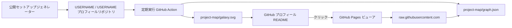

<p align="center">
  <a href="https://nekomario28.github.io/interactive-project-map/u/?username=nekomario28&style=galaxy-systems">
    
  </a>
</p>

<h1 align="center">GitHub Project Galaxy</h1>

<p align="center">
  GitHub のポートフォリオを、プロフィール用の静的グラフィックとインタラクティブなプロジェクトマップに変換します。<br/>
  <strong>ユーザー自身が所有する単一グラフ · 12 種類のビジュアル表示 · 通常閲覧時の共有 API 呼び出しゼロ</strong>
</p>

<p align="center">
  <a href="https://github.com/nekomario28/interactive-project-map/actions/workflows/ci.yml"></a>
  <a href="https://github.com/nekomario28/interactive-project-map/actions/workflows/deploy-pages.yml"></a>
  <a href="LICENSE"></a>
</p>

<p align="center">
  <a href="README.md">English</a>
  &nbsp;·&nbsp;
  <strong>日本語</strong>
  &nbsp;·&nbsp;
  <a href="docs/public-users.md">公開導入実績</a>（<a href="data/public-users.json">検証データ</a>）
</p>

<p align="center">
  <a href="https://nekomario28.github.io/interactive-project-map/"><strong>ジェネレーターを開く</strong></a>
  &nbsp;·&nbsp;
  <a href="https://nekomario28.github.io/interactive-project-map/u/?username=nekomario28&style=galaxy-systems">ライブデモ</a>
  &nbsp;·&nbsp;
  <a href="#クイックスタート">クイックスタート</a>
  &nbsp;·&nbsp;
  <a href="#ビジュアルプリセット">プリセット</a>
  &nbsp;·&nbsp;
  <a href="docs/README.md">ドキュメント</a>
  &nbsp;·&nbsp;
  <a href="CONTRIBUTING.md">開発参加</a>
  &nbsp;·&nbsp;
  <a href="#ライセンス">ライセンス</a>
</p>

---

## 概要

Project Galaxy は、公開されている GitHub リポジトリ群を再利用可能なポートフォリオグラフに変換します。生成される成果物はすべてあなた自身のプロフィールリポジトリ（`USERNAME/USERNAME`）に保存されます。

```text
project-map/
├── galaxy.svg
└── graph.json
```

`galaxy.svg` はプロフィール README に埋め込む静的画像です（他のプリセットを選択した場合も、後方互換性のためファイル名は `galaxy.svg` に固定されます）。`graph.json` はインタラクティブビューアが読み込むグラフデータです。

リポジトリの種別は明示的に区別されます。**Original**（自作）、**Fork**（フォーク）、**Archived**（アーカイブ済み）、およびオプトインの **Contributed**（外部コントリビュート）が曖昧に1つの所有概念へ統合されることはありません。Contributed は**既定でオフ**であり、他者・他組織が所有するリポジトリへの限定的な公開貢献を表します（それらのリポジトリの所有権を主張するものではありません）。

## クイックスタート

必要なのは GitHub アカウントと、`USERNAME/USERNAME` という名前の**公開プロフィールリポジトリ**だけです。ローカル環境へのインストールや Personal Access Token（PAT）の発行は不要です。

### 1. セットアップ設定を生成する

**[公開ジェネレーター](https://nekomario28.github.io/interactive-project-map/)** を開き、GitHub ユーザー名を入力してビジュアルプリセットとリポジトリフィルタを選択します。テーマ設定は静的 SVG 画像に適用されます（既定プリセットは **Radial Tree**、Contributed はオプトイン）。プロフィールリポジトリがまだない場合は、ジェネレーターの **Step 0** から作成できます。

### 2. ワークフローを保存して実行する

ジェネレーターの **Step 1** で完全なワークフロー定義をコピーし、プロフィールリポジトリの `.github/workflows/project-map.yml` エディタを開いて貼り付け・コミットします。続いて **Step 2** から **Update project map** を1回手動実行します。

実行が完了すると、`project-map/galaxy.svg` と `project-map/graph.json` がプロフィールリポジトリにコミットされ、以降はスケジュールに従って自動更新されます。ワークフローは GitHub 標準の `github.token` を使用し、メタデータ取得・生成ジョブは読み取り専用（`contents: read`）、ファイル反映用の別ジョブ（`publish`）のみが最小限の書き込み権限（`contents: write`）を持ちます。

### 3. プロフィール README にマップを追加する

ジェネレーターの **Step 3** に表示されるスニペットを `USERNAME/USERNAME` の `README.md` に貼り付けます。静的画像 `project-map/galaxy.svg` から、選択したプリセットのインタラクティブビューアへリンクされます。既定の Radial Tree プリセットの場合は以下のスニペット（`USERNAME` を置換）でも動作します。

```html
<p align="center">
  <a href="https://nekomario28.github.io/interactive-project-map/radial/?username=USERNAME">
    
  </a>
</p>
```

## ビジュアルプリセット

既定プリセットは `radial` です。旧指定の `style=galaxy` は `galaxy-systems` へのエイリアスとして動作します。

| プリセット | ビューアルート | 適した用途 |
|---|---|---|
| `radial` | `/radial/` | コンパクトなプロフィール README・汎用デフォルト |
| `galaxy-classic` | `/u/` | 単一銀河の雰囲気と全体の軌道モーション |
| `galaxy-systems` | `/u/` | カテゴリ → リポジトリの空間的な所属関係の明確化 |
| `galaxy-hybrid` | `/u/` | 渦巻銀河の雰囲気と読みやすいローカル星系の両立 |
| `obsidian` | `/u/` | 力学モデル（Force-directed）による有機的な探索 |
| `tree` | `/tree/` | Owner → Category → Repository の明示的な階層表示 |
| `treemap` | `/treemap/` | 高密度なポートフォリオ構成比の可視化 |
| `timeline` | `/timeline/` | カテゴリ別のリポジトリ作成タイムライン |
| `cluster` | `/cluster/` | 大規模ポートフォリオにおけるカテゴリ集中度 |
| `sunburst` | `/sunburst/` | コンパクトな階層・比率の放射状表示 |
| `matrix` | `/matrix/` | Category × Language（カテゴリ×言語）のクロス構成 |
| `sankey` | `/sankey/` | Owner → Category → リポジトリ種別のフロー可視化 |

すべてのプリセットは同一のグラフデータを共有し、同じリポジトリ種別セマンティクスを維持します。Obsidian 風レンダラーは独自実装であり、Obsidian および Dynalist Inc. とは提携・承認関係にありません。

## アーキテクチャ



GitHub REST API は、ユーザーのワークフローがリポジトリメタデータを更新するときにのみ使用されます。通常の README 表示およびインタラクティブマップ閲覧時は `raw.githubusercontent.com/USERNAME/USERNAME/HEAD/project-map/graph.json` の静的ファイルを読むため、共有の GitHub REST API クォータを消費しません。

呼び出し側ワークフローでは、生成権限と公開（コミット）権限を分離しています。

```text
generate
  contents: read
  再利用ワークフロー（interactive-project-map）
       ↓ artifact
publish
  actions: read
  contents: write
  固定の project-map 出力パスへのコミット
```

再利用ワークフロー側に書き込み可能なトークンが渡されることはありません。また、各ビューアは描画前にオーナー識別子、リポジトリ URL、ラベル、トピック、ノード／エッジ数、エッジ形式を検証し、欠損や不正なグラフに対しては共有 API へフォールバックせずセットアップ／復旧案内を表示します。

## 設定リファレンス

生成されるワークフローは、安定版 `@v1` チャネル（またはレビュー済みの40文字コミットSHA。詳細は [`docs/release-chain.md`](docs/release-chain.md) と [`docs/update-policy.md`](docs/update-policy.md)）の再利用ワークフローを呼び出します。

```yaml
uses: nekomario28/interactive-project-map/.github/workflows/generate-project-map.yml@v1
with:
  theme: dark
  style: radial
  max_repos: "100"
  forks: true
  archived: false
  contributed: false
  width: "740"
  height: auto       # または "600" 等の固定ピクセル高さ（Galaxy 系を枠内に自動スケール）
  padding: "24"
```

| 入力 | 既定値 | 説明 |
|---|---:|---|
| `theme` | `dark` | 静的 SVG のテーマ（`dark` または `light`） |
| `style` | `radial` | 12 種類のプリセット ID のいずれか |
| `max_repos` | `100` | 対象リポジトリの最大数（`1`〜`300`） |
| `forks` | `true` | フォークしたリポジトリを含めるか |
| `archived` | `false` | アーカイブ済みリポジトリを含めるか |
| `contributed` | `false` | 他者所有リポジトリへの限定的な公開コントリビュートを含めるか（所有権は変更しない） |
| `width` | `740` | SVG の幅（`420`〜`1600`px） |
| `height` | `auto` | Galaxy 系: 自動高さまたは固定フレーム（`260`〜`1000`px）。他スタイルはネイティブの `420`px レイアウト |
| `padding` | `24` | Galaxy グラフ周囲の余白（`0`〜`100`px、凡例領域とは別枠） |

Galaxy 系スタイルでは軌道範囲全体を含めてフレーム内にスケーリングし、凡例領域を別途確保します。独自の `github_token`、`username`、`output_dir` を直接指定したい上級用途では [`action.yml`](action.yml) を直接呼び出すことも可能です。

## 開発とドキュメント

```bash
npm ci --ignore-scripts
npm run build:pages
npm test
npm run verify
```

ローカル開発要件（Node.js 24 推奨）、Playwright E2E テスト、変更時の制約については [`CONTRIBUTING.md`](CONTRIBUTING.md) を参照してください。

- [`docs/README.md`](docs/README.md) — ドキュメント全体の目次と調査・意思決定エビデンス一覧
- [`docs/current-roadmap.md`](docs/current-roadmap.md) — 現在の開発対象と本番境界（休眠中の Cloudflare Worker / GitHub App 経路を含む）
- [`docs/research-decision-ledger.md`](docs/research-decision-ledger.md) — 採用・完了・却下・休眠の意思決定台帳
- [`SECURITY.md`](SECURITY.md) — 権限境界、シークレット管理方針、脆弱性報告窓口

## コントリビューター・ライセンス

メンテナーおよびコントリビューターには [Yuu / nekomario28](https://github.com/nekomario28) と [SYUN / syun88](https://github.com/syun88) が含まれます。実装判断の参考にした公開プロジェクトや論文の境界については [ライセンス監査記録](docs/licensing-audit-2026-08-21.md) を参照してください。

本プロジェクトのコードは **[MIT License](LICENSE)**（`Copyright (c) 2026 interactive-project-map contributors`）の下で提供されます。3D ビューアは MIT ライセンスの **[Three.js](https://github.com/mrdoob/three.js)** を同梱しています（[`THIRD_PARTY_NOTICES`](THIRD_PARTY_NOTICES) を参照）。マップ上に表示される各リポジトリのライセンスおよび所有権はそれぞれの所有者に帰属します。
