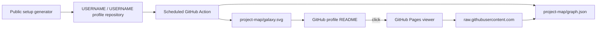

<p align="center">
  <a href="https://nekomario28.github.io/interactive-project-map/u/?username=nekomario28&style=galaxy-systems">
    
  </a>
</p>

<h1 align="center">GitHub Project Galaxy</h1>

<p align="center">
  Turn a GitHub portfolio into a static profile graphic and an interactive project map.<br/>
  <strong>One user-owned graph. Twelve visual views. No shared API call during normal viewing.</strong>
</p>

<p align="center">
  <a href="https://github.com/nekomario28/interactive-project-map/actions/workflows/ci.yml"></a>
  <a href="https://github.com/nekomario28/interactive-project-map/actions/workflows/deploy-pages.yml"></a>
  <a href="LICENSE"></a>
  &nbsp;·&nbsp;
  <a href="README.ja.md">日本語</a>
</p>

<!-- public-users:start -->
<p align="center">
  <a href="docs/public-users.md"><strong>Public users: 4 verified GitHub accounts</strong></a><br />
  <sub>Public profile installations · includes maintainers · checked 2026-10-31 · <a href="data/public-users.json">evidence</a></sub>
</p>
<!-- public-users:end -->

<p align="center">
  <a href="https://nekomario28.github.io/interactive-project-map/"><strong>Open generator</strong></a>
  &nbsp;·&nbsp;
  <a href="https://nekomario28.github.io/interactive-project-map/u/?username=nekomario28&style=galaxy-systems">Live demo</a>
  &nbsp;·&nbsp;
  <a href="#quick-start">Quick start</a>
  &nbsp;·&nbsp;
  <a href="#visual-presets">Presets</a>
  &nbsp;·&nbsp;
  <a href="docs/README.md">Docs</a>
  &nbsp;·&nbsp;
  <a href="CONTRIBUTING.md">Contributing</a>
  &nbsp;·&nbsp;
  <a href="#license">License</a>
</p>

---

## What it does

Project Galaxy turns public GitHub repositories into a reusable portfolio graph. Your profile repository owns the generated artifacts:

```text
project-map/
├── galaxy.svg
└── graph.json
```

`galaxy.svg` is the static README image (kept under that filename across all presets for backwards compatibility). `graph.json` drives the interactive viewers.

Repository status remains explicit: **Original**, **Fork**, **Archived**, and opt-in **Contributed** are not silently merged into one ownership meaning. Contributed is **off by default** and represents bounded public work in repositories owned by other people or organizations; it never means that you own those repositories.

## Quick start

You need a GitHub account and a **public profile repository** named `USERNAME/USERNAME`. No local installation or personal access token is required.

### 1. Generate your setup

Open the **[public generator](https://nekomario28.github.io/interactive-project-map/)**, enter your GitHub username, and choose a visual preset and repository filters. The theme applies to the static README image. The default preset is **Radial Tree**; Contributed is opt-in. If your profile repository does not exist yet, use the generator's **Step 0** to create it.

### 2. Save and run the workflow

Use **Step 1** to copy the complete workflow and open GitHub's editor for `.github/workflows/project-map.yml` in your profile repository. Commit the workflow, then use **Step 2** to run **Update project map** once.

Wait for the run to finish. It commits `project-map/galaxy.svg` and `project-map/graph.json` to your profile repository and refreshes them on a schedule. The workflow uses GitHub's built-in token: generation has read-only metadata access, and a separate publish job holds the narrow write permission needed to commit the generated files.

### 3. Add the map to your README

Copy the generator's **Step 3** snippet into `USERNAME/USERNAME`'s `README.md`. It links `project-map/galaxy.svg` to the interactive viewer for your chosen preset. For the default Radial Tree preset:

```html
<p align="center">
  <a href="https://nekomario28.github.io/interactive-project-map/radial/?username=USERNAME">
    
  </a>
</p>
```

## Visual presets

`radial` is the default preset. Legacy `style=galaxy` aliases to `galaxy-systems`.

| Preset | Viewer route | Best for |
|---|---|---|
| `radial` | `/radial/` | compact profile README and general default |
| `galaxy-classic` | `/u/` | original one-galaxy atmosphere and global motion |
| `galaxy-systems` | `/u/` | clear category → repository spatial membership |
| `galaxy-hybrid` | `/u/` | spiral atmosphere plus readable local systems |
| `obsidian` | `/u/` | organic force-directed exploration |
| `tree` | `/tree/` | explicit Owner → Category → Repository hierarchy |
| `treemap` | `/treemap/` | dense portfolio composition |
| `timeline` | `/timeline/` | repository creation history by category |
| `cluster` | `/cluster/` | category concentration in large portfolios |
| `sunburst` | `/sunburst/` | compact proportional hierarchy |
| `matrix` | `/matrix/` | Category × Language composition |
| `sankey` | `/sankey/` | Owner → Category → repository-status flow |

All presets consume the same graph and preserve the same repository-status semantics. The Obsidian-like renderer is independently implemented and is not affiliated with or endorsed by Obsidian or Dynalist Inc.

## Architecture



The GitHub REST API is called only when the user's workflow refreshes repository metadata. Normal README views and interactive-map views read the static files from `raw.githubusercontent.com/USERNAME/USERNAME/HEAD/project-map/graph.json` without spending a shared REST quota.

The caller workflow separates generation and publishing permissions:

```text
generate
  contents: read
  reusable interactive-project-map workflow
       ↓ artifact
publish
  actions: read
  contents: write
  fixed project-map output paths
```

The reusable generator never receives the caller's write-capable publish token. Every viewer validates owner identity, repository URLs, labels, topics, node/edge counts, and supported edge forms before rendering, showing setup/recovery guidance if the graph is missing or invalid rather than falling back to a shared API call.

## Setup configuration

The generated workflow calls the reusable workflow on the stable `@v1` channel (or a reviewed 40-character commit SHA; see [`docs/release-chain.md`](docs/release-chain.md) and [`docs/update-policy.md`](docs/update-policy.md)):

```yaml
uses: nekomario28/interactive-project-map/.github/workflows/generate-project-map.yml@v1
with:
  theme: dark
  style: radial
  max_repos: "100"
  forks: true
  archived: false
  contributed: false
  width: "740"
  height: auto       # Or "600" for a fixed frame that scales Galaxy styles to fit
  padding: "24"
```

| Input | Default | Meaning |
|---|---:|---|
| `theme` | `dark` | `dark` or `light` static SVG theme |
| `style` | `radial` | one of the 12 preset IDs |
| `max_repos` | `100` | `1`–`300` eligible repositories |
| `forks` | `true` | include forks |
| `archived` | `false` | include archived repositories |
| `contributed` | `false` | include bounded public contributions owned by others without changing ownership |
| `width` | `740` | SVG width, `420`–`1600`px |
| `height` | `auto` | Galaxy family: automatic height, or a fixed `260`–`1000`px frame; other styles use their native `420`px layout |
| `padding` | `24` | Space around the fitted Galaxy graph, `0`–`100`px (separate from the legend area) |

Galaxy styles scale the graph (including full orbit bounds) to fit the frame and reserve a separate area for the legend. Lower-level callers that need custom `github_token`, `username`, or `output_dir` inputs can invoke [`action.yml`](action.yml) directly.

## Development and documentation

```bash
npm ci --ignore-scripts
npm run build:pages
npm test
npm run verify
```

See [`CONTRIBUTING.md`](CONTRIBUTING.md) for local toolchain requirements (Node.js 24 recommended), Playwright E2E suites, and change constraints.

- [`docs/README.md`](docs/README.md) — full documentation map and research provenance index.
- [`docs/current-roadmap.md`](docs/current-roadmap.md) — active work and production boundaries (including dormant Cloudflare Worker / GitHub App paths).
- [`docs/research-decision-ledger.md`](docs/research-decision-ledger.md) — adopted, completed, rejected, and dormant decisions.
- [`SECURITY.md`](SECURITY.md) — permission boundaries, secrets policy, and vulnerability reporting.

## Contributing and issues

Issues and pull requests are welcome. Before proposing larger changes or new presets, please review [`CONTRIBUTING.md`](CONTRIBUTING.md) to preserve the static-first architecture, layout determinism, and backwards compatibility.

## Contributors and license

Maintainers and contributors include [Yuu / nekomario28](https://github.com/nekomario28) and [SYUN / syun88](https://github.com/syun88). Public projects and papers that informed implementation choices are recorded in the [historical licensing audit](docs/licensing-audit-2026-08-21.md).

Project code is licensed under the **[MIT License](LICENSE)** (`Copyright (c) 2026 interactive-project-map contributors`). The 3D viewer bundles **[Three.js](https://github.com/mrdoob/three.js)** under its MIT license; see [`THIRD_PARTY_NOTICES`](THIRD_PARTY_NOTICES). Repositories displayed in a map retain their own licenses and ownership.
